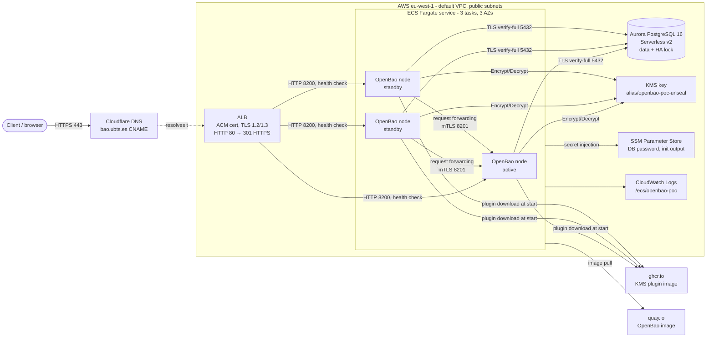

# OpenBao on AWS: architecture (POC → enterprise baseline)

This document describes the proof of concept (POC) as built and validated in
this repository. It then lists what has to change to turn it into an
enterprise environment. Day-to-day status and the runbook live in
[`PLAN.md`](../PLAN.md). The source of truth for the details is the Terraform
in [`terraform/`](../terraform).

## 1. Summary

| | POC (this repo) |
|---|---|
| Product | OpenBao 2.7.1 (`quay.io/openbao/openbao`) |
| Topology | 3 nodes, 1 active + 2 standby (HA) |
| Compute | ECS on Fargate, ARM64, 0.25 vCPU / 0.5 GB per task, spread over 3 AZs |
| Storage | PostgreSQL backend on Aurora PostgreSQL 16 Serverless v2 (0–1 ACU, scale to zero) |
| HA coordination | Lock in PostgreSQL (`ha_enabled = true`), no Raft quorum |
| Unseal | AWS KMS auto-unseal via the external plugin `openbao-plugin-kms-aws` v0.1.0 |
| Ingress | Internet-facing ALB, TLS with an ACM certificate, `https://bao.ubts.es` |
| DNS | Cloudflare, CNAME to the ALB (DNS-only, not proxied) |
| Region | eu-west-1 (AZs a, b, c) |
| IaC | Terraform, state in S3 with native locking |
| Cost | ~$0.15–0.20/h while up; ~$1–1.5/month while down |

## 2. Component view



### 2.1 Compute: ECS on Fargate

- One ECS service, `desired_count = 3`, `FARGATE` launch type, ARM64 (Graviton).
  The tasks run in the default subnets, one per AZ, so a single-AZ outage
  leaves 2 nodes.
- No custom image. The task overrides the entrypoint with
  [`files/bao-entrypoint.sh`](../terraform/files/bao-entrypoint.sh). The script
  reads the task's IP from ECS task metadata and writes the server config
  (`api_addr`, `cluster_addr`) at start. This is needed because Fargate IPs
  change every time a task is replaced.
- Rolling deploys: `minimum_healthy_percent = 66`, `maximum_percent = 134`.
  ECS replaces one node at a time, so at least 2 nodes serve during an upgrade.
- ECS Exec is enabled for debugging.

### 2.2 Storage and HA: PostgreSQL backend

- Aurora uses a custom cluster parameter group with `rds.logical_replication = 1`.
  OpenBao 2.7 read-enabled standbys need the WAL LSN to track cache invalidations,
  and Aurora only exposes it with logical replication on (static parameter: writer reboot).

- All nodes share one Aurora PostgreSQL database. OpenBao creates its tables
  itself (`openbao_kv_store` plus the HA lock table).
- HA is a lock row in PostgreSQL. Whoever holds the lock is active. Standbys
  serve reads themselves (OpenBao 2.7 read-enabled standbys) and forward writes
  to the active node over the cluster port (8201,
  always mutual TLS).
- **There is no quorum.** Unlike Raft storage, the nodes hold no data. One
  surviving node is enough to serve. Availability and durability are delegated
  entirely to the database.
- Connection: `sslmode=verify-full` against the regional RDS CA bundle.
  `max_connect_retries = 0` makes OpenBao retry forever. This covers the Aurora resume after a pause (measured up to ~80 s; the ECS
  health-check grace period is 180 s for that reason). Previously documented as ~15 s:
  Aurora resume after a pause.
- Aurora Serverless v2 with `min_capacity = 0`: the database pauses after
  5 minutes without connections. That is a cost choice for the POC, not an
  enterprise setting. There is a single writer instance (no reader) and backups
  are kept for 1 day.

### 2.3 Seal: AWS KMS auto-unseal (plugin)

- Nodes unseal themselves on start using a dedicated KMS key with yearly
  rotation. The task role may only call `kms:Encrypt`, `kms:Decrypt` and
  `kms:DescribeKey` on that key.
- **From OpenBao 2.7.0 the `awskms` seal is no longer built in.** It is
  declared as a KMS plugin, and the plugin name must match the seal name:

  ```hcl
  plugin_directory     = "/tmp/plugins"
  plugin_auto_download = true
  plugin "kms" "awskms" {
    image = "ghcr.io/openbao/openbao-plugin-kms-aws:v0.1.0@sha256:fe9fb948…"
  }
  seal "awskms" { region = "…"  kms_key_id = "…" }
  ```

  Every task downloads the plugin from ghcr.io at start, pinned by digest.
  2.7.1 without this block fails with `unknown wrapper: awskms`.
- With auto-unseal, `init` produces **recovery keys** (3 shares, threshold 2),
  not unseal keys. In the POC they are stored, together with the root token, in
  SSM Parameter Store (`/openbao-poc/init`, SecureString). That is acceptable
  only for a POC; see §6.4.

### 2.4 Network and ingress

- Default VPC with public subnets. Tasks get public IPs for egress only (image
  pulls, plugin download, AWS APIs), which avoids a NAT gateway.
- Security groups:
  - ALB: 80/443 from `allowed_cidrs` (default `0.0.0.0/0`); egress only to the
    nodes on 8200.
  - Nodes: 8200 from the ALB; 8200–8201 between nodes; all egress.
  - DB: 5432 from the nodes only.
- TLS terminates at the ALB (ACM certificate validated through Cloudflare DNS,
  policy `ELBSecurityPolicy-TLS13-1-2-2021-06`). **ALB → node traffic on 8200
  is plain HTTP inside the VPC.** `x_forwarded_for` is trusted from the VPC
  CIDR.
- ALB health check: `/v1/sys/health?standbyok=true&uninitcode=200`, so
  standbys and not-yet-initialized nodes count as healthy.

### 2.5 Secrets, identity, observability

- DB password: generated by Terraform, stored in SSM (SecureString), and
  injected into the task as `PGPASSWORD` by the execution role. Terraform state
  also contains it, which is one reason the state bucket is private and
  encrypted.
- IAM: separate execution role (pull, logs, read the DB password) and task
  role (KMS, ECS Exec).
- Logs: CloudWatch `/ecs/openbao-poc`, 7-day retention. No audit device, no
  metrics/telemetry and no alarms are configured.
- Cost guard: an AWS Budget ($10/month) is created once `alert_email` is set.

### 2.6 Operations model

- `running` Terraform variable plus `scripts/up.sh` / `scripts/down.sh`. Down
  removes the ECS service, the ALB and the DNS record; Aurora then pauses.
- `scripts/init-openbao.sh` initializes once and checks health.
  `scripts/failover-test.sh` stops the active task while reading a secret
  through the ALB twice a second.

## 3. Validated behaviour (2026-10-10)

| Test | Result |
|---|---|
| Deploy from scratch | 34 resources, ~10 min (Aurora is the slow part) |
| 3 nodes healthy behind the ALB, HA enabled, 1 active | OK |
| Failover on 2.6.4 (stop active task) | Standby took over; 91 reads, 0 failed |
| Rolling upgrade 2.6.4 → 2.7.1 with the KMS plugin | No downtime; data kept; all nodes `builtin: false` seal |
| Failover on 2.7.1 | 94 reads, 1 failed (sub-second) |
| Down → up | Data kept; already initialized; auto-unsealed |

Lessons learned:
- Pin image versions and read release notes. 2.7 removed built-in KMS seals,
  and the upgrade path is the plugin.
- During an election `/sys/leader` briefly reports no leader. Clients and
  scripts must retry.
- In one test a freshly started replacement node won the lock instead of a
  waiting standby. That is harmless with a shared database, but worth
  understanding before setting enterprise SLOs.

## 4. POC shortcuts (deliberate)

| Area | POC choice | Why it is not enterprise-ready |
|---|---|---|
| Network | Default VPC, public subnets, public IPs on tasks | No isolation; internet egress from the nodes |
| Exposure | Internet-facing ALB, `0.0.0.0/0` | Secrets API reachable by anyone |
| TLS | Terminated at the ALB, HTTP to the nodes | No end-to-end encryption; no client certificates |
| Database | Serverless v2 0–1 ACU, single instance, 1-day backups, scale to zero | Cold starts, no failover replica, short recovery window |
| Root material | Root token + recovery keys in one SSM parameter | Single point of compromise |
| Supply chain | Images and plugin pulled from quay.io / ghcr.io at runtime | Depends on third-party registries; no scanning |
| Identity | Root token only | No SSO, no least privilege |
| Audit | None | No record of who read which secret |
| Monitoring | Logs only | No metrics, alerts or SLOs |
| DR | Single region | No regional recovery |
| Change management | Applied from a workstation/session | No pipeline, review or drift detection |

## 5. Production recommendation

**Recommendation:** keep the POC's shape (stateless OpenBao on ECS Fargate, PostgreSQL storage on Aurora, KMS auto-unseal) and harden it. Choose Raft storage on VMs or Kubernetes only if the organization already runs Kubernetes and wants OpenBao independent of the database.

The main reason is operations. The nodes hold no data, so a node is just a container ECS can replace. There are no disks, no quorum, no cluster membership and no OpenBao-specific backups to manage; AWS runs the hard part (the database). The trade-off is that everything depends on Aurora, so Aurora has to be built for high availability.

### 5.1 Production shape

- **Compute:** 3 Fargate tasks across 3 AZs at about 1 vCPU / 2 GB each, private subnets, no public IPs, VPC endpoints for AWS services.
- **Ingress:** an internal load balancer with TLS all the way to the nodes (certificates from a private CA). Use an NLB with TLS passthrough if clients will log in with certificates.
- **Database:** Aurora PostgreSQL with a writer plus a reader in another AZ. Serverless v2 with at least 1 ACU and no auto-pause, or provisioned r7g.large if load is steady. Backups for 14–35 days, point-in-time recovery, deletion protection, a customer-managed KMS key.
- **Seal:** a customer-managed KMS key in a security account (multi-Region for DR). The KMS plugin is baked into an image kept in a private ECR.

### 5.2 What it means for each area

| Area | What to expect | What to do |
| --- | --- | --- |
| Scalability | Since 2.7, standbys serve **reads** themselves (read-enabled standbys) and forward only writes to the active node. Read capacity therefore grows with node count; write capacity is one node plus one database writer, so scale writes up, not out. On Aurora this requires `rds.logical_replication = 1` (OpenBao tracks the WAL LSN to invalidate standby caches); without it standbys log `wal_level must be set to 'logical'` non-stop. Fargate goes to 16 vCPU / 120 GB per task. | Load test with the real mix (logins, KV reads, dynamic secrets): reads scale with standbys, logins and writes do not. Track the active node's CPU and latency. If writes ever outgrow one node, split into separate clusters per domain or tenant. |
| Performance | Each request goes client → load balancer → node (→ active node) → Aurora, inside one region: a few milliseconds of overhead. Cache misses and writes cost a database round trip. Logins and dynamic secrets are the heavier calls, not KV reads. | No database auto-pause (the POC's ~15 s resume is unacceptable). Keep the database in the same AZs. Use client-side token reuse and caching (OpenBao Agent or Proxy) for chatty apps. |
| Availability | One AZ down: the remaining nodes take over in seconds (measured: 1 failed request out of 94). Database failover: Aurora promotes the reader in about 30 s or less, and OpenBao reconnects by itself. Expected availability is roughly that of Aurora Multi-AZ, 99.95–99.99%. | Writer plus reader is mandatory. Health checks and alarms on leadership changes and sealed nodes. Rolling upgrades one node at a time (proven in the POC). Clients retry. |
| Operations overhead | Low. No servers or OS patching, no disks, no quorum repair. Upgrades are a Terraform change and a rolling deploy, tested on a copy first. Remaining work is OpenBao itself (policies, auth methods, audit, upgrades) plus normal Aurora care such as minor version upgrades in a maintenance window. | Everything as code through CI/CD. Runbooks for unseal and recovery, generating a root token, database restore and region failover. Roughly part of one engineer's time, versus noticeably more for self-run Raft clusters. |
| Security | Biggest gaps today: the POC is public with plain HTTP behind the load balancer, and the root token and recovery keys sit in one place. | Private network only (or WAF plus mTLS if external access is needed). TLS to the nodes. SSO for people, IAM auth for workloads, least-privilege policies. Two audit devices shipped to the SIEM. Recovery keys encrypted with PGP keys of named custodians; root token revoked. Database credentials rotated or IAM-based. Images scanned and pinned in ECR. Separate prod account with SCPs. |
| Disaster recovery | Inside one region the design is already resilient. Losing the region needs a plan. | Pick a target first. Warm standby: Aurora Global Database (about 1 s of data lag, about 1 min to promote), a multi-Region KMS key, a copy of the stack in the DR region at desired count 0, and DNS failover. That gives roughly RPO under 1 min and RTO of 15–30 min. Cheaper option: cross-region snapshot copies (RPO of hours, RTO of about an hour). Test failover at least twice a year. For accidental deletion of secrets, Aurora point-in-time recovery restores the whole store to a moment in time. |
| Cost (rough, eu-west-1) | About $500–900 a month per production region. Aurora (writer plus reader) is the largest share, then VPC endpoints, about $90 for the 3 tasks, load balancer, KMS and logs. A warm DR region adds about half again. | Serverless v2 at a 1 ACU minimum if load is light; provisioned instances when load is steady. Share VPC endpoints with other workloads if the network team runs them centrally. |
| Support and maturity | OpenBao is community-run (Linux Foundation). The PostgreSQL backend and the KMS plugin are newer and less battle-tested than Raft. Upgrades can carry breaking changes, as the 2.7 seal change showed. | Pin versions and follow release notes. Keep a non-production cluster one version ahead. Decide the support model (internal ownership or a third-party support contract). Track the plugin repository too. |

### 5.3 When to choose Raft instead

When the platform is Kubernetes (EKS) with a team that runs stateful workloads, when OpenBao must have no database dependency, or when the plan relies on OpenBao features built around Raft (for example snapshots driven by OpenBao itself). The price is more operations work: volumes, quorum (3 or 5 nodes), autopilot settings and snapshot schedules.

### 5.4 Decisions that change this design

- Will apps reach it only from inside the corporate network?
- Is Kubernetes already in use?
- What RPO and RTO does the business need?
- Roughly how many clients and requests per second?

## 6. Enterprise target: detailed recommendations

### 6.1 Network
- Dedicated VPC per environment (or shared VPC from a network account) with
  **private subnets** across 3 AZs. No public IPs on tasks.
- VPC endpoints for ECR (api + dkr), S3, KMS, SSM/Secrets Manager, CloudWatch
  Logs and STS, so nodes need no internet egress at all.
- **Internal ALB/NLB** reachable over Transit Gateway / Direct Connect / VPN.
  If external access is required, put it behind WAF and an allowlist or mTLS.
  Private DNS (Route 53 private hosted zone) for the internal name.

### 6.2 TLS end to end
- Enable TLS on the OpenBao listener (8200) with certificates from a private CA
  (AWS Private CA or OpenBao's own PKI bootstrapped once). Use an
  HTTPS target group, or an NLB with TLS passthrough so clients can use client
  certificates and `cert` auth.
- Advertise `https://` `api_addr`. TLS 1.2+ only.

### 6.3 Storage backend decision
Two viable options; pick one explicitly:

| | PostgreSQL (as POC) | Integrated storage (Raft) |
|---|---|---|
| Data location | Aurora (managed) | Local on each node (needs EBS/EFS → ECS on EC2 or EKS) |
| Quorum | None; DB is the SPOF | Majority required (3 or 5 nodes) |
| Backups/DR | Aurora PITR, snapshots, Global Database | `bao operator raft snapshot` |
| Ops skills | DBA / RDS | OpenBao-specific |
| Fits Fargate | Yes | Poorly (no stable local storage) |

For a Fargate-based platform, keep **PostgreSQL** with:
- Aurora **provisioned** or Serverless v2 with `min_capacity ≥ 0.5` (no
  pause), a writer plus at least one reader in another AZ for fast failover.
- Backup retention 14–35 days, PITR, deletion protection, final snapshot on.
- Customer-managed KMS key for storage encryption, Performance Insights,
  `rds.force_ssl = 1`.
- IAM database authentication or a Secrets Manager-managed password with
  rotation, instead of a static password.

### 6.4 Seal and key management
- Customer-managed KMS key in a dedicated security account, key policy limited
  to the task role. Consider a **multi-Region key** to support DR.
- At `init`, encrypt the recovery keys with **PGP keys of named custodians**
  (`recovery_pgp_keys`) and distribute them. Never store them all together.
- **Revoke the initial root token** once SSO and an admin policy exist.
  Generate a new one only through the recovery-key quorum when needed.

### 6.5 Supply chain
- Mirror the OpenBao image and the KMS plugin into **private ECR** with
  scanning and immutable tags. Pin by digest.
- Better: build an image that bakes in the plugin binary (verified
  `sha256sum`), so starts do not depend on any registry download.
- Track OpenBao releases. Test upgrades in a lower environment, and take a DB
  snapshot before each one, as in this POC.

### 6.6 Identity and access
- Human access through **OIDC/SSO** (corporate IdP) mapped to OpenBao
  policies and groups.
- Workloads use the **AWS IAM auth method** (ECS/EKS/Lambda roles),
  Kubernetes auth, or AppRole for anything else.
- Least-privilege policies managed as code (Terraform `vault` provider or
  OpenBao config pipeline). Namespaces per tenant/team if multi-tenant.

### 6.7 Audit, monitoring, alerting
- At least two **audit devices** (file to stdout → CloudWatch, plus socket or a
  second file), so a failed audit device does not block requests. Ship them to
  the SIEM.
- Telemetry (Prometheus or StatsD/CloudWatch) with alarms on: sealed nodes,
  leadership changes, request latency/errors, DB connections/CPU, KMS errors,
  ECS task restarts, ALB 5xx and unhealthy targets.
- Log retention aligned with the compliance policy (often ≥ 1 year for audit).

### 6.8 Availability and DR
- 3 nodes across 3 AZs (as POC), sized from load tests. 0.25 vCPU is too small
  for production; start around 1 vCPU / 2 GB.
- Define RPO/RTO. Cross-region DR: Aurora Global Database or cross-region
  snapshot copy, multi-Region KMS key, and a standby ECS service (desired 0) in
  the DR region, plus a DNS failover runbook. Test it periodically.

### 6.9 Delivery and governance
- Separate AWS accounts per environment (dev / staging / prod) under AWS
  Organizations with SCPs.
- Terraform through a CI/CD pipeline (plan on PR, apply on merge) with a
  locked-down deploy role, remote state per account, and drift detection.
- Tagging, budgets and cost allocation per environment. Always on (no
  `running` switch) in production.

## 7. From POC to enterprise: suggested steps

1. Decide the storage backend (§6.3) and the network model (§6.1). These
   drive everything else.
2. Build the landing zone: accounts, VPC, endpoints, private DNS, ECR
   mirror.
3. Harden this Terraform: private subnets, internal LB, end-to-end TLS,
   provisioned Aurora, customer-managed keys, alarms, audit devices.
4. Ceremony: `init` with PGP-encrypted recovery keys, SSO set up, root token
   revoked.
5. Onboard a pilot application with IAM auth. Run load, failover, upgrade
   and DR tests, and record the results here as in §3.
